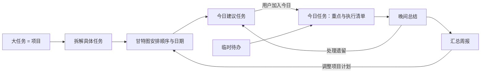

# Praxis 产品方案

> 2026-11-10 范围更新：本项目仅做个人管理，旧文中的团队或多用户协作候选取消。当前需求和任务以 [个人版 PRD](docs/prd-mvp-v0.1.md)与[个人版开发计划](docs/mvp-development-plan-2026-11-09.md)为准；正文保留历史记录。

> 版本：V1.2 品牌确认稿 · 2026-09-14  
> 主要使用端：桌面端、移动端；Web 作为补充入口  
> 核心定位：以今日任务为中心，把大任务拆成项目执行计划，让用户明确每天做什么、优先做什么，并通过晚间总结与周报持续调整。

## 1. 产品定位与核心目标

### 1.0 产品名称与演进方向

- **英文名称：Praxis**，表达将想法转化为实践。
- **品牌标语：Turn intent into action.**（把意图变成行动。）
- **首页名称：Today（今日任务）**，作为每日执行的核心入口。
- **当前定位**：以项目拆解和今日任务为核心的个人任务管理工作台。
- **长期方向**：逐步演进为用户自己的 Te 系统，围绕目标、规划、执行与反馈形成个人管理体系；决策、资源分配等能力按实际需求逐步扩展。

品牌名称不绑定单一待办功能。长期方向不改变本版 MVP 范围，优先完成项目拆解、每日执行、晚间总结和周报闭环。

### 1.1 一句话定位

一款着重参考 Todo 清单软件使用方式的个人任务管理工作台：把一个大任务作为一个项目，拆成具体任务，通过甘特图安排顺序与日期，将可执行事项推荐到今日任务，在执行后形成晚间总结和周报。

### 1.2 核心问题

1. 大任务太模糊，不知道从哪一步开始，也不知道怎样拆解。
2. 同时推进多个项目，不确定今天具体做哪些事、哪些最重要。
3. 项目有整体计划，但计划没有落实到每天的任务清单。
4. 临时事项不断插入，原来的重要任务容易被挤掉。
5. 每天做了很多事，却难以回顾项目进展、阻塞和下一周的安排。

### 1.3 产品闭环



今日任务是产品首页和最高频操作页面。项目三视图负责拆解、排期与跟踪；日历列表负责按日期查看每天的任务；总结和周报负责把执行结果反馈给后续安排。

## 2. 设计原则与范围

- **任务优先**：首页首先展示需要执行的任务、重要性及完成操作，统计、计时和其他信息居于辅助位置。
- **大任务即项目**：以“项目 → 任务 → 可选子任务”为基本层级，不要求用户先创建长期目标或里程碑。
- **每日清单易用**：参考 Todo 清单软件的快速添加、勾选完成、重要标记、日期切换和任务详情等交互方向。
- **建议有来源**：今日建议从项目拆解任务中产生，遵循甘特计划、任务依赖与优先级，展示推荐理由。
- **计划与承诺分开**：甘特图表示项目计划，加入某日清单表示用户决定当天执行；建议尚未接受时不算当天待办。
- **多视图共用任务**：今日任务、日历列表、项目任务视图、甘特图和看板使用同一份任务数据。
- **轻量开始**：临时待办只填写标题即可保存，项目归属、估时、时间段均可后补。
- **双端协同**：桌面端负责项目拆解和整体规划；移动端负责随手记录、查看今日、执行与总结，两端均可完成核心流程。

首版聚焦个人任务管理，不纳入团队审批、复杂权限、健康与情绪追踪等扩展模块。专注计时为辅助能力，不作为完成任务或生成总结的前提。

## 3. 典型使用流程

| 时机 | 用户操作 | 产品结果 |
|---|---|---|
| 开始大任务 | 新建项目，填写预期结果，手动或借助 AI 拆解任务 | 获得可执行任务及建议顺序 |
| 安排项目 | 在甘特图设置日期、依赖和任务顺序 | 形成项目计划，作为每日建议的依据 |
| 早晨打开 | 查看今日已安排事项和建议任务，选择重点 | 确认今天具体做什么、先做什么 |
| 执行中 | 勾选完成、开始任务或标记阻塞 | 所有任务视图同步状态 |
| 临时插入 | 在今日任务直接添加临时待办 | 默认进入今天，无须先选择项目 |
| 查看后续 | 打开日历列表并切换日期 | 看见每天已安排任务和项目计划候选 |
| 晚间 | 查看已完成与未完成任务，补充总结 | 保存当日记录，处理遗留，准备明日建议 |
| 周末 | 查看按项目汇总的周报并补充下周重点 | 调整项目优先级、甘特计划和下周安排 |

## 4. 信息架构

```text
个人工作台
├─ 今日任务（默认首页）
│  ├─ 今日重点
│  ├─ 今日待办（含临时待办）
│  ├─ 建议任务
│  ├─ 已完成（可折叠）
│  └─ 晚间总结入口
├─ 日历列表
│  ├─ 按日分组的任务列表
│  ├─ 日期导航／周与月日期选择
│  └─ 指定日期添加任务
├─ 项目
│  ├─ 全部项目／重点项目／归档项目
│  └─ 项目详情
│     ├─ 任务视图
│     ├─ 甘特图视图
│     └─ 看板视图
├─ 总结与周报
│  ├─ 每日总结
│  └─ 每周周报
├─ 收件箱（未安排事项）
└─ 设置（提醒、同步、导出、AI）
```

桌面端左侧导航置顶“今日任务”，并提供快捷项目入口。移动端底部导航为“今日、日历、项目、回顾”，快速添加按钮常驻，收件箱通过今日页或更多菜单进入。

## 5. 核心对象与数据规则

### 5.1 对象定义

| 对象 | 含义 | 主要字段 |
|---|---|---|
| 项目 Project | 一个需要拆解的大任务 | 名称、预期结果、优先级、目标日期、状态、是否重点 |
| 任务 Task | 一项可执行且能判断完成的行动 | 标题、项目（可空）、父任务（可空）、重要度、状态、截止时间、预估工作量 |
| 项目排期 ProjectSchedule | 任务在项目甘特计划中的安排 | 任务、计划开始日、计划结束日、排序、依赖任务 |
| 每日安排 DailyPlanItem | 某项任务在哪一天执行 | 任务、执行日期、当日预计投入、当日排序、是否今日重点、可选时间段 |
| 执行记录 ExecutionRecord | 某天对任务的实际推进 | 任务、日期、完成或部分推进、进展说明、可选实际耗时 |
| 每日总结 DailyReview | 晚间对当天执行的总结 | 日期、执行快照、用户笔记、遗留处理、明日关注 |
| 周报 WeeklyReport | 按周汇总任务和项目进展 | 周期、项目进展、完成事项、遗留与阻塞、下周重点、关联每日总结 |
| 建议 Recommendation | 从项目计划生成的候选任务 | 任务、建议日期、依据、计划版本、接受或忽略结果 |

项目状态为草稿、进行中、暂停、完成、归档。任务状态为待办、进行中、阻塞、完成、取消；是否已安排、是否来自临时录入是独立属性，避免与执行状态混用。

### 5.2 三种日期分别表示什么

- **项目计划开始／结束日**：甘特图中的预计执行窗口，用于项目排期和每日推荐。
- **每日执行日期**：用户实际决定在哪天推进任务，用于今日任务和日历中的已安排清单；一项任务可分多天推进。
- **截止时间**：任务真正需要完成的期限，调整日常执行安排不会自动改变截止时间。

时间段为可选项。用户可以只安排“今天做”，无需填入几点到几点。同一任务在同一天只能有一条每日安排；需要分段执行时，在该安排下增加时间段。

### 5.3 数据一致性

- 任务归属于最多一个项目，可以有子任务；临时待办允许暂不归属项目。
- 今日、日历和项目三视图展示同一任务，加入今日不会复制任务。
- 项目无日期的任务进入“未排期”，在任务视图和甘特图侧栏可见；可手动加入今日。
- 修改状态、标题、重要度在各视图同步；任务完成后不再出现在未完成候选中。
- 将任务从今天移到明天只修改每日安排；若超出甘特计划窗口，提示项目排期偏差并提供调整入口。
- 甘特排期变更使相关建议失效并重新计算；已确认的每日安排保留，冲突单独提示。
- 跨日任务的每日推进写入执行记录，只有完成全部工作才将任务标记完成；项目完成数量按唯一任务计算。
- 有子任务的父任务作为汇总项，默认仅推荐可执行叶子任务，避免父子任务重复排入今日或重复计入进度。

## 6. 核心功能

### 6.1 今日任务（P0，产品核心）

首页回答三个问题：今天需要做哪些事、哪些最重要、完成以后下一步做什么。

| 区域 | 展示内容 | 主要操作 |
|---|---|---|
| 顶部日期与快速添加 | 今日日期、完成进度、任务输入框 | 切换日期、添加临时待办 |
| 今日重点 | 用户选定的重点任务，建议 1—3 项 | 调整顺序、开始、完成、取消今日重点 |
| 今日待办 | 已确认今天执行的其他任务，含临时事项 | 勾选完成、编辑、改期、标记阻塞 |
| 建议任务 | 根据项目甘特计划筛出的下一步任务 | 加入今日、设为重点并加入、改日、今日忽略 |
| 已完成 | 今天完成的事项，默认折叠 | 查看结果、撤销误完成 |
| 晚间总结入口 | 当日总结状态和遗留数量 | 生成草稿、补充、保存 |

**交互规则：**

- “今日重点”是每日安排属性；任务本身的重要度用于长期排序，二者分别保存。
- 今日重点中的任务不在今日待办分组重复出现；取消今日重点后回到普通待办。
- 每行至少显示完成框、标题、重要标记；项目、估时、截止日期按需显示。
- 阻塞任务单独提示原因，保留在已安排清单中供处理，不作为可立即开始的任务。
- 昨日未完成任务以“遗留待处理”提示出现，由用户选择今天、其他日期或待安排，不自动无限滚入当天。
- 可设置今日可用时长；有估时的任务显示负载，无估时任务标记“待估时”，不按零分钟计算。
- 临时任务或手动加入导致超量时提示负载，允许用户自行取舍；系统不静默移走已确认任务。

### 6.2 建议任务（P0）

建议任务是项目拆解后的实际任务在当天的候选展示。首版必须能通过明确规则生成，不依赖 AI 服务可用。

**生成顺序：**

1. 从进行中项目读取未完成的可执行叶子任务及甘特排期。
2. 以“计划窗口包含今天”或“计划开始日在今天之前但尚未完成”为主要候选。
3. 排除已完成、已取消、正在阻塞、前置依赖未完成的任务；暂停和归档项目不参与推荐。
4. 排除今天已经安排的任务；已明确改到未来日期的每日安排不自动提前，必要时提示排期偏差。
5. 按硬截止风险、任务重要度、项目优先级、甘特图内任务顺序排序；同等级优先推荐计划日期较早的任务。
6. 根据今日剩余容量呈现少量首选，其余可展开查看。估时未知的任务允许推荐，但不宣称整份计划一定能在容量内完成。

**顺序与依赖规则：**

- 有前置依赖的任务必须先满足条件；紧急或重要不能越过依赖直接推荐执行。
- 可并行任务可以同时进入候选，无须等整个上一阶段全部结束。
- 某个任务完成后，重新检查后续任务；后续计划在未来时仅提供“可提前推进”入口，用户主动选择后才能加入今日。
- 没有已排期候选时，提示去项目补充排期，也可展示单独标注的“未排期待安排”任务，不伪造甘特计划。
- 今天忽略的建议当天不反复出现，次日按最新计划重新判断；“改日”则保存明确的未来安排。

每条建议显示所属项目、计划日期、重要度和一句依据，例如：“文章发布项目 · 按计划今天写初稿 · 资料整理已完成”。接受后关联原任务创建每日安排，并从建议区移除。重复点击或多端同时接受不得产生重复安排。

### 6.3 每日临时待办与收件箱（P0）

- 在今日任务输入框添加事项，默认安排今天并标记临时录入来源；只要求标题。
- 在日历列表的某一天添加，默认安排到该天，提交前明确显示日期。
- 在全局快速入口添加但未指定日期，默认进入收件箱。
- 临时事项可标记重要、调整执行日期、补充备注、归入已有项目。
- 临时事项扩展成大任务时，支持转为项目并继续拆解，保留原事项关联和历史记录。
- 每日总结区分原定计划与当天临时新增，帮助判断重要任务是否被临时事项挤占。

### 6.4 日历列表（P0）

以按日分组的任务列表为主，可通过日期条或月历选择日期，连续浏览过去和未来每天要做的事。精确到小时的时间轴为后续增强功能。

每个日期组包含：

- **已安排**：该日的每日安排，显示重点、任务状态、项目及可选时间。
- **项目计划候选**：按甘特图预计应在该日推进、但未确认的任务，明确标注“建议”；可一键安排到该日。
- **完成记录**：已发生的完成与推进事实，便于回看。
- **添加任务**：直接插入该日待办。

任务可通过日期选择器改期；桌面端可拖动至另一日期组。跨多日的甘特任务可以在多个日期的候选区出现，但始终关联同一任务，不代表已经安排了每天的工作量。历史日期只保留当时的安排和执行记录，不用当前项目计划重新生成过去的建议。

### 6.5 项目拆解与三视图（P0）

一个大任务对应一个项目。新建时填写名称和预期结果；目标日期、优先级、阶段和预计投入可后补。项目顶部展示结果、进度、目标日期与下一个可执行任务，主体固定提供任务、甘特图、看板三个视图。

**拆解流程：**

1. 写清大任务完成后的结果，例如“发布一篇介绍个人工作台的文章”。
2. 拆成收集素材、整理提纲、写初稿、修改、发布等行动，按需增加子任务。
3. 为任务补充完成标准、预估工作量与依赖，阶段分组可选。
4. 在甘特图安排计划日期和顺序，确认后作为每日建议来源。

手动拆解是基础能力；AI 可根据结果、期限和可投入时间生成可编辑草稿。用户确认后创建正式任务，不能直接覆盖已安排的项目。

| 视图 | 用途 | 首版能力 |
|---|---|---|
| 任务视图 | 拆解和编辑项目行动 | 列表、子任务、重要度、日期、状态、排序、加入今日 |
| 甘特图视图 | 安排任务执行顺序与时间 | 按日显示任务条、开始／结束日期、依赖、调整排期、未排期列表、今日线 |
| 看板视图 | 跟踪任务推进状态 | 待办、进行中、阻塞、完成四列，移动卡片或通过菜单改变状态 |

**三视图联动规则：**

- 任务视图新增任务，立即出现在看板待办列；填写计划日期后显示在甘特图中。
- 看板移动只修改任务状态，不自动改写日期。完成后今日和日历同步显示结果。
- 甘特图修改日期更新项目排期与候选建议；如果影响后续依赖，先展示受影响任务及重排方案。
- 禁止循环依赖。首版采用“前置任务完成后才可开始”的依赖关系，其他复杂关系后续评估。
- 暂停项目停止新建议，已有每日安排提示用户保留或移出，不直接删除。
- 取消任务在任务视图中可筛选查看，默认不占看板主列。

### 6.6 晚间总结（P0）

今日任务页提供固定入口，支持用户设置晚间提醒。系统先基于任务记录生成结构化草稿，用户补充后保存。

**总结内容：**

- 今天完成了什么：按项目归类，单独列出临时事项。
- 今日重点推进情况：完成、部分推进、未推进及简短说明。
- 未完成和阻塞任务：原因可选，支持逐项或批量处理去向。
- 临时待办的影响：新增多少、完成哪些、是否影响原定安排。
- 明日关注：需要优先处理的任务与阻塞。
- 自由笔记：收获、问题及其他补充。

未完成任务可以安排明天、改到指定日期、移回待安排、标记阻塞或取消。允许先保存总结再处理遗留，未处理项继续提示；不能为了生成完整总结而强制用户全部改期。

总结保存当日计划和执行快照。之后改期不改写历史事实；事实修正或撤销误完成时，提示更新相应总结及周报草稿。接入首版指与任务及执行记录关联，外部笔记平台导入或同步作为后续集成。

### 6.7 周报汇总（P0）

默认按周一至周日汇总，可在周末提醒查看。周报读取本周任务执行记录、项目变化与每日总结，没有写总结的日期仍可依据任务记录生成内容。

| 模块 | 内容 |
|---|---|
| 本周概览 | 原计划任务、完成事项、临时新增、重点任务推进情况 |
| 按项目汇总 | 本周成果、完成任务、部分推进、项目进度与计划偏差 |
| 遗留与阻塞 | 未完成事项、延期情况、依赖卡点 |
| 每日总结摘录 | 用户记录的收获、问题和重要决定 |
| 下周计划 | 沿甘特排期汇总下一周候选、建议重点及需要调整的日期 |

基础周报采用确定性模板生成，AI 润色为可选能力。每条成果可回溯到任务或总结，不能把“计划做”写成“已经完成”。跨日任务只计一次完成，部分推进另列；投入统计只使用已记录时长，缺失时标为未记录。

用户可编辑、保存和导出 Markdown。保存后的周报保留版本；源数据修正时标记可更新，由用户刷新。下周建议经用户确认才修改每日安排或项目排期，周报不自动发送给他人。

## 7. 页面草图与双端体验

### 7.1 桌面端：今日任务

```text
┌────────────┬─────────────────────────────────────┬────────────────────┐
│ 今日任务   │ 今日任务 · 9 月 14 日       完成 2/6 │ 选中任务详情       │
│ 日历列表   │ [＋ 添加今天的临时待办……]           │ 标题／重要度       │
│ 项目       │                                     │ 所属项目／子任务   │
│ 总结与周报 │ 今日重点                            │ 项目计划／执行日期 │
│ 收件箱     │ □ ★ 完成文章初稿        写作项目    │ 截止时间／依赖     │
│            │                                     │ 备注／执行记录     │
│ 重点项目   │ 今日待办                            │                    │
│ · 文章发布 │ □ 回复合作需求            临时新增 │                    │
│ · 产品开发 │ □ 整理测试结果            产品开发 │                    │
│            │                                     │                    │
│            │ 建议任务                            │                    │
│            │ 修改文章配图    [加入今日] [改日]   │                    │
│            │ 按甘特计划今天开始，前置任务已完成 │                    │
│            │                                     │                    │
│ ＋新建项目 │ 已完成（2）⌄          [晚间总结]    │                    │
└────────────┴─────────────────────────────────────┴────────────────────┘
```

沿用 Todo 清单软件易扫描的列表交互方向。桌面端采用导航、任务列表、可收起详情的三栏结构，任务列表占主要空间。未选中任务时收起详情，不用仪表盘填满首页。

### 7.2 桌面端：项目详情

```text
文章发布项目                 目标：周五发布文章      [编辑项目]
[任务视图] [甘特图视图] [看板视图]                   [辅助拆解]

甘特图：          周一    周二    周三    周四    周五
收集素材         ━━━ 完成
整理提纲         ━━━ 完成
撰写初稿                 ━━━━━━━
修改校对                                  ━━━
发布文章                                          ◆

依赖：整理提纲 → 撰写初稿 → 修改校对 → 发布文章
点击任务查看详情；调整日期后显示对后续任务和每日安排的影响。
```

### 7.3 移动端：今日任务

```text
┌─────────────────────────┐
│ 今日 · 9 月 14 日   日历 │
│ [＋ 添加临时待办]        │
│ 今日重点                │
│ □ ★ 完成文章初稿        │
│   文章发布 · 预计 60 分钟│
│ 今日待办                │
│ □ 回复合作需求  临时新增│
│ 建议任务                │
│ 修改文章配图 [加入今日] │
│ 按项目计划今天开始      │
│ 已完成（2）⌄            │
│ [晚间总结]              │
│ 今日  日历  项目  回顾  │
└─────────────────────────┘
```

### 7.4 跨端分工

| 能力 | 桌面端 | 移动端 |
|---|---|---|
| 今日任务与重要标记 | 键盘与鼠标高效批量处理 | 点按完成、快捷改期、随手录入 |
| 日历列表 | 连续日期浏览、跨日拖拽 | 日期切换、列表浏览、日期选择器改期 |
| 项目任务视图 | 批量拆解、子任务编辑 | 查看、添加、修改任务 |
| 甘特图 | 完整排期与依赖编辑 | 横向浏览、点按任务修改日期与依赖 |
| 看板 | 拖动卡片切换状态 | 横向切列，菜单切换状态 |
| 总结与周报 | 查看完整内容、编辑与导出 | 完成晚间总结、阅读与编辑周报 |
| 快速入口 | 首版应用内快捷键 | 首版常驻添加按钮 |

首版同时验收桌面端和移动端核心流程。两端可共享业务逻辑，但分别适配交互，不将桌面甘特图直接缩小到手机屏幕。Web 可复用界面作为补充，不作为先于双端核心体验的独立交付阶段。全局快捷窗、桌面悬浮计时、小组件和语音录入列为后续增强。

## 8. MVP 范围与迭代顺序

| 优先级 | 功能范围 | 验证目标 |
|---|---|---|
| P0 | 今日任务、重点标记、临时待办、收件箱、日历列表、项目拆解、任务／甘特图／看板三视图、按计划推荐、晚间总结、基础周报、桌面与移动同步、导出 | 完整跑通“项目拆解 → 每日执行 → 日总结 → 周报调整” |
| P1 | AI 辅助拆解与总结润色、批量智能重排、可选时间块、外部日历接入、重复任务、专注计时、全局快捷录入、小组件 | 降低录入和规划成本，提升使用便利性 |
| P2 | 高级甘特依赖、模板、自动化、外部笔记平台集成、开放接口 | 根据真实使用需求扩展 |

### 8.1 首版验收场景

1. 创建“文章发布”项目，拆出五项任务，设置日期和前后依赖，可在任务、甘特图、看板看到同一组数据。
2. 打开今日页，只推荐排期适合且前置条件满足的任务；前置未完成的任务不能因优先级高而被推荐执行。
3. 将建议加入今日并设为重点，在今日和日历中显示为已安排；连续点击及双端操作不产生重复任务或重复每日安排。
4. 在今日插入不归属项目的临时待办，能够标记重要、完成、改期，之后可以归入项目。
5. 日历列表能逐日显示已安排事项及明确标注的计划候选；在未来日期添加任务不会误入今天。
6. 完成任务后，项目三视图同步状态；后续任务满足依赖时成为可用候选，未来任务不会自动提前进入今日。
7. 甘特计划延期时展示影响；已有每日安排不被静默移动，循环依赖被阻止。
8. 跨日任务可以记录每日部分推进，最终只计一次完成；父任务汇总不与子任务重复统计。
9. 晚间总结包含完成、重点推进、临时新增和遗留，可安排明日并保留当天历史。
10. 无需 AI、无需每天填写总结，也能生成基于任务事实的基础周报；用户可编辑、保存和导出。
11. 桌面和移动端均可查看今日建议、添加临时待办、改期、完成任务和写总结；离线修改联网后能同步。
12. 今日已超量、任务无估时、项目暂停、没有已排期任务时，都有明确提示和可继续操作的入口。

### 8.2 实施顺序

- 第一步：打通项目、任务、每日安排的数据关系，完成今日清单、临时录入和日历列表。
- 第二步：实现项目三视图、依赖与基础排期规则，接通今日建议及变更提示。
- 第三步：接入执行记录、晚间总结与基础周报，完成双端同步、离线与验收。
- 第四步：依据真实使用反馈增强 AI、时间规划、系统快捷入口及外部集成。

前三步共同构成完整 MVP，不能将甘特图、看板或周报推迟到首版之后。

## 9. 同步、历史与提醒

- 核心实体统一标识，多端同步同一任务及每日安排；每日安排按“任务＋日期”去重。
- 离线支持录入、改期、完成和记录总结，恢复联网后同步；同一字段并发冲突保留冲突值与历史，提示用户处理。
- 完成、取消、改期和批量调整支持撤销；历史总结和已保存周报保留版本。
- 默认提醒范围为用户设置的任务提醒、晚间总结和周报；建议任务不会逐条推送。
- AI 是可关闭的辅助功能，未开启或服务不可用时，任务管理、规则建议和模板总结仍可使用。
- 导出包含项目、任务、每日安排、执行记录、每日总结及周报；外部服务接入单独配置授权。

## 10. 成功指标

核心衡量：用户能否持续把大任务拆解为项目任务，并在每天完成有价值的推进。

- 激活：创建一个项目、拆解任务、安排甘特日期并从建议接受首项今日任务的比例。
- 今日决策效率：从打开首页到确认今日重点所需的时间。
- 项目任务执行：每周完成或有明确进展记录的项目任务数，避免只统计临时琐事。
- 建议采用率：建议被加入当日安排的比例及用户调整原因。
- 重点推进率：今日重点完成或部分推进的比例，部分推进与完成分别呈现。
- 回顾闭环：晚间总结保存率、周报查看率、回顾后调整项目计划的比例。
- 负向指标：持续遗留、频繁超量、建议忽略、重复记录和同步冲突。

## 11. 本次需求映射

| 用户要求 | 本方案落点 | 优先级 |
|---|---|---|
| 最核心是今日任务 | 默认首页，重点、待办、建议、完成和总结围绕清单组织 | P0 |
| 拆解大任务，明确每天做什么 | 大任务作为项目，拆任务、排甘特计划、接受每日建议 | P0 |
| 知道重要任务有哪些 | 任务重要度、项目优先级、今日重点三者明确分工 | P0 |
| 日历列表看见每天要做的事 | 按日分组，区分已安排任务与项目计划候选 | P0 |
| 每日任务插入临时待办 | 指定日期直接添加，无需项目归属 | P0 |
| 今日任务下有按甘特顺序产生的建议 | 基于排期、依赖和任务顺序生成可接受的候选 | P0 |
| 接入晚间总结，汇总周报 | 基于执行事实生成可编辑的每日总结与基础周报 | P0 |
| 每个项目有任务、甘特图、看板视图 | 三视图共用同一任务数据并同步修改 | P0 |
| 着重参考 Todo 清单软件 | 快速录入、清单勾选、重要标记、日期浏览、任务详情 | 整体交互原则 |
| 主要使用桌面端和移动端 | 双端核心流程同步验收，桌面规划与移动执行分别适配 | P0 |

## 12. 参考说明

- 主要参考方向：Todo 清单软件的任务列表组织和日常执行交互，具体功能以本方案需求为准。
- 原稿曾记录界面参考文件 `codex-clipboard-2f9e4445-1b3a-4bb0-8215-b881c52ff45a.png`；本次未重新核验该图片，不据此新增配色或具体界面事实。
- 后续界面设计优先验证今日任务、日历列表、项目三视图和移动端操作的可用性，避免首页演变为复杂统计面板。

