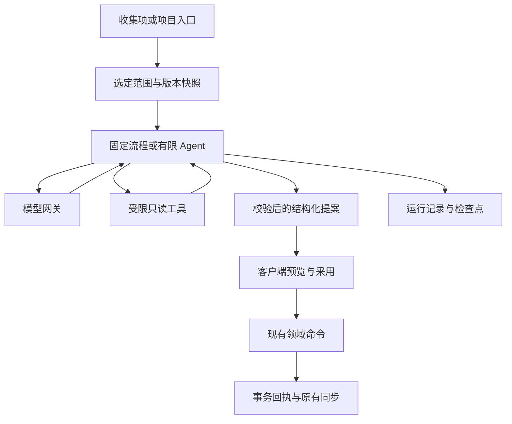

# Praxis AI Agent 引入方案与修仙主题取舍

> 后续方向确认（2026-10-25）：用户确认当前实现为自身修炼界面，没有灵宠。下文关于灵宠的对比保留为最初方案分析，不作为本轮开发任务。最新交互与边界见 `docs/implementation-ai-planner-v1.md`。

日期：2026-10-25（香港时间）  
用途：产品决策与后续开发规格，尚未实施功能

## 1. 建议结论

Praxis 适合采用：**对象内的规划助手 + 固定业务流程 + 少量受限 Agent 循环 + 明确的业务执行边界。**

首批入口是“整理这条灵感”“把目标拆成步骤”“继续这个项目”。今日安排与回顾在此基础上扩展。模型帮助理解意图、发现缺少的信息、生成和调整草稿；业务程序处理日期、依赖、权限、版本、提交、撤销和奖励。

修仙主题建议采用：**自身修炼作为主线，灵宠作为后续可选陪伴。** 用户的现实推进属于自身成长；AI 可以表现为“规划助手／护道者”，帮助修订路径。修为、境界和现实奖励由用户约定与确定性规则处理，不由模型临时裁决。

这是根据三章笔记、现有项目实现和本轮产品目标提出的设计判断，并未经过真实用户验证。当前只新增方案文档，不修改应用逻辑，也不将原工单状态改成已实施。

## 2. 笔记怎样转化为产品决策

阅读方式：检查三章目录、主要概念、工程边界、验收规则及关键流程；重点阅读模型协议、工具治理、Planning、Checkpoint、Harness、人工确认与编排章节。未逐行审查所有教学代码及附录实现。

| 笔记依据 | 在 Praxis 中的具体决策 |
|---|---|
| 第一章 §1.1：Prompt、Context、Runtime、Harness、Loop、Graph 各有职责 | 一套运行底座服务多个场景，不为每个页面另造一个 Agent |
| 第一章 §1.2、§1.5：结构化输出还需应用校验 | 输出可被界面消费的提案，不用正则从回答里抽任务；格式合法仍需业务校验 |
| 第一章 §1.3：事件流、取消、重放不同 | 展示真实处理状态；关闭面板不等于停止；断线先重连，不重新生成另一套任务 |
| 第一章 §1.4：提示词与数据、权限分开 | 灵感原文、网页摘录、任务备注都是数据，不能授予写权限或改变奖励规则 |
| 第一章 §1.6—§1.7：Gateway 统一调用、错误与预算 | 密钥与模型适配放服务端；先实现产品所需的小型 ModelPort，不必先复刻完整兼容平台 |
| 第二章 §2.1—§2.2：模型提出动作，Runtime 受控执行 | 按本次场景只开放少量业务工具；读工具和实际写任务之间有明确边界 |
| 第二章 §2.3：MCP 负责外部能力接入 | 首版直接复用内部业务能力；未来连接日历或笔记时再引入 MCP Adapter |
| 第二章 §2.4：身份可信、确认绑定参数、幂等与状态未知 | 账号与资源范围来自登录态；确认绑定提案版本；超时后先查提交结果 |
| 第三章 §3.1—§3.2：按任务选择 Workflow、Loop、Planning | 抽取与简单拆解用固定流程；需要查询后调整方案时才用受限循环 |
| 第三章 §3.2：完成标准、依赖、证据与版本 | 计划里有具体产物和依赖；AI 建议改计划时给出依据和差异，不整份覆盖 |
| 第三章 §3.3：恢复现场不等于恢复聊天 | 保存草稿、来源版本、预算和未决动作；恢复时核对最新项目，避免重复创建 |
| 第三章 §3.5—§3.7：同一事实进入上下文、状态和验收 | 界面说“已创建”必须有领域命令回执；模型说完成不能替代实际结果 |

课程主要用代码 Agent 举例。迁移时应保留工程原则，并调整业务含义：个人任务通常以用户自报完成为有效记录，不要求每次提交照片或文件来证明；系统验收检查的是 Agent 交付和记录一致性，不是替用户评判人生目标。

## 3. 先区分三个容易混淆的对象

| 对象 | 时间跨度 | 例子 | 谁决定完成 |
|---|---|---|---|
| 用户项目计划 | 数天到数月 | 做完摄影作品集 | 用户与项目完成标准 |
| Agent 本次运行 | 通常几秒到几分钟 | 读取项目、核对约束、生成下一步草稿 | 程序检查本次交付契约 |
| 修炼成长记录 | 长期累计 | 一次行动贡献修为、一个成果支持突破 | 事件与用户确认的成长规则 |

“Agent 已生成计划”不表示作品集完成。“任务在系统中被用户标记完成”也不表示模型已经鉴定了作品质量。各层的状态与责任必须独立。

长期目标不需要一个持续运行几个月的模型进程。每次用户操作，或以后明确开启的提醒事件，触发一段有范围、有预算的短运行；项目和进展在业务数据库中长期保存。

## 4. 自身修炼与灵宠：如何选择

| 维度 | 自身修炼 | 灵宠陪伴 |
|---|---|---|
| 核心感受 | 我的行动让我变强 | 我的行动与一个伙伴建立联系 |
| 对 Praxis 的价值表达 | 直接对应目标、能力与成果 | 更擅长鼓励、庆祝与回归接纳 |
| 主要风险 | 等级变成自我评价压力，任务被当成刷修为工具 | 喂养、清洁等变成额外义务，成长归属转移到宠物 |
| 首版可以做到的范围 | 一条修为进度、少量境界、个人里程碑 | 一只灵宠、少量成长阶段与反馈 |
| 内容成本 | 简单界面可以较轻；加入装备、战斗后会迅速扩大 | 动作与外观内容较多；具体成本仍需设计估算 |
| 建议位置 | 主成长线 | 可选陪伴与装饰 |

### 推荐的具体实现

1. 默认任务管理术语清楚可读：“今日任务、项目、完成、回顾”。修仙层在成长页表现，不强制把所有任务改称副本或功法。
2. 完成行动或记录有效推进，增加累计修为；无需强制启动计时器。
3. 境界体现阶段成果：累计推进达到条件，并完成用户事先认可的一个里程碑，再确认突破。
4. 例如学习摄影的阶段成果可以是“完成第一组作品并做一次自评”；不是默认要求连续七天上线。
5. 小任务有合理反馈，关键成果有明显反馈；同一个工作包拆成多个子任务不能凭空扩大总修为。
6. 缺席不掉境界、不扣已得修为。支持休息与暂停，不制造“灵力溢出浪费”迫使用户上线。
7. 现实奖励绑定成果，例如“发布第一组作品后安排一次摄影出游”；解锁与领取分开。
8. 灵宠后续可跟随阶段成果变化，提供欢迎回来、庆祝与陪伴，不新增必须照顾的日常负担。

这些都是待测试的设计。推荐自身修炼，是因为本产品的核心价值是个人行动与成长；并不代表已证明它对所有用户比宠物更有效。

## 5. 按价值与复杂度选择 AI 场景

| 场景与触发 | 用户拿到什么 | 合适的实现 | 首版范围 |
|---|---|---|---|
| 收集项旁“帮我整理” | 行动、项目、资料或奖励的建议去向 | 固定 Workflow + 一次结构化生成 | 做 |
| 项目空态“拆成步骤” | 少量任务、完成标准和最小下一步 | 固定 Workflow；必要时补问一次 | 做 |
| 项目页“继续推进” | 上次停在哪里、可执行下一步、阻塞项 | 只读查询 + 有限 Agent Loop | 做 |
| 今日页“我只有 30 分钟” | 从真实候选中选出的行动与取舍 | 程序过滤和负载校验 + AI 解释／建议 | 后续扩展 |
| 回顾页“根据记录回顾” | 有来源的成果、未完成与调整建议 | 确定性事实汇总 + 模型组织文字 | 后续扩展 |
| 奖励设置“帮我定条件” | 可编辑的成果与奖励约定 | 固定流程生成草稿 | 随奖励系统加入 |
| 发修为、判断突破、发奖 | 稳定、可解释的状态变化 | 业务规则与用户确认 | 不交给 Agent 判断 |
| 自主购买奖励、自动重排所有任务 | 大范围副作用 | 超出首版授权和价值验证范围 | 暂不做 |

课程 §3.2 明确指出固定字段处理和短流程不必上 Planner。这里不把所有带模型的按钮都叫 Agent；只有需要根据工具返回的新事实继续决策的场景，才启用循环。

首版采用一个统一助手及多个场景配置。它们共享上下文、工具治理、提案协议和运行状态，不做“目标 Agent、拆解 Agent、奖励 Agent、宠物 Agent”彼此传话。

## 6. 用户实际怎样使用

### 场景一：灵感与奖励混合输入

用户输入：“我想把摄影练起来，做一个作品集，做完想奖励自己一支镜头。”

**立即保存原文**，不要求先与 AI 对话。

用户点击“帮我整理”后，助手在原记录旁给出：

- 目标建议：完成一个摄影作品集。
- 奖励建议：完成用户确认的阶段成果后解锁镜头奖励。
- 需要补充：希望什么时候完成，每周大约有多少时间。
- 操作：调整用途、继续拆解、暂时只保存。

“想买镜头”也可能本身是采购研究项目。分类可改，不凭一句话固定为奖励。

已有信息足够时不追问；不确定的假设直接列出，可由用户修改。首轮通常只问影响计划最大的一个或两个问题。

### 场景二：从目标到今天的一步

用户确认每周约两小时后，返回一张可编辑提案卡：

- 项目预期结果与阶段成果。
- 三到五个候选步骤，数量是初始产品假设，按真实目标可调整。
- 最小下一步，例如“挑出最近拍摄中最满意的 10 张照片”；估时区间是建议，不是保证。
- 每步完成标准、依赖和需要用户判断的假设。
- 默认保存为未安排任务，不给每一步编造硬截止时间。

主操作：“采用选中步骤”。用户可选“把第一步加入今天”。预览明确写出将新建、关联和安排的内容，一次确认完成这一批操作。

用户只需改计划卡，不必通过多轮聊天要求“把第二项换个说法”。

### 场景三：计划被打乱

用户点击“继续项目”，补充“这周很忙，今天只有二十分钟”。

助手读取当前项目、已完成与阻塞项、用户明确可用的时间，查询后再调整建议。已经明确排到未来的事项不悄悄提前，前置未完成的任务不推荐立即执行。

若原任务太大，给出一个保留原目标的较小步骤；若发现原假设不成立，给出局部修改建议及其原因。既有任务、截止时间和完成标准不自动被覆盖。

### 场景四：回来继续修炼

一段时间未使用后，先展示上次的真实进展与一个可开始的小动作。AI 可以用修仙语气鼓励，但不推断用户懒惰、不擅自诊断动机。

用户选择继续后才生成新安排。修为保留；灵宠如已启用，承担欢迎与陪伴。

## 7. 好用的交互边界

- **入口贴着对象。** 收集项、项目和今日页面各有具体动作；全局聊天面板作为补充。
- **阅读不反复审批。** 用户选择某项目时明确显示本次范围，范围内的只读查询自动进行。
- **普通录入保持直接。** “明天九点提醒我交材料”这类明确、可逆的单项指令可以按原意执行并反馈撤销。
- **AI 推断出的批量变更用预览确认。** 不对每个子任务单独弹窗，也不让用户在同一批操作中重复授权。
- **确认后内容变化才重新检查。** 修改对象、日期、任务数量或提案版本时，原确认不能被移用；同一操作的结果查询与成功回执重放不需要再确认。
- **状态可理解。** 展示“正在读取当前项目”“步骤已准备”“需要补充时间”等事实，不输出冗长思维过程。
- **可以停止和离开。** 关闭面板与取消生成分开；未提交内容标明草稿。
- **失败仍保留输入。** 支持手动继续，不让模型服务故障阻塞日常任务管理。

## 8. 与现有工程怎样衔接

当前项目已具备：

- React 客户端与共享 TypeScript 应用层。
- Tauri/Rust 本地领域命令与 SQLite，移动端也有自己的存储和命令处理。
- Fastify + TypeScript + SQLite 的账号和同步 API。
- `operationId`、`expectedVersion`、重试保护、内容澄清和撤销等基础模式。
- `CaptureItem`、`ContentRecord`、`ProjectContext`，以及预期结果、下一步和恢复提示。
- 已规划但尚未实现的 T32 项目恢复摘要、T33 收件箱建议、T34 周回顾草稿。

因此，建议复用这些入口和领域语义，不另建 AI 专用任务库。当前资料没有证明已部署可直接复用的课程模型网关；若实际已有稳定服务可适配，否则先在 API 内实现产品所需的小模块。

### 分层

| 层 | 职责 | 建议位置 |
|---|---|---|
| 交互与上下文选择 | 对象入口、授权范围、可编辑预览、应用与撤销 | 现有客户端 |
| 提案协议与纯校验 | 严格 Schema、引用检查、日期与依赖规则、变更摘要 | 共享应用层或小型共享 AI contracts 包 |
| Agent 运行服务 | Run、预算、状态、上下文装配、受限工具与提案 | API 内独立模块 |
| Model Gateway | Provider 适配、结构化生成、有限重试、用量 | 服务端 |
| 业务写入 | 对当前本地版本校验，以正常领域命令原子应用 | 现有桌面／移动命令边界 |
| 同步与成长 | 正常任务同步、完成事件、修为与奖励规则 | 现有业务层，成长能力后续增量加入 |

建议目录只是后续实现选项，不是本轮已经创建的代码：`apps/api/src/ai/`、共享 contracts，以及客户端的提案卡组件。

### 首版执行路径

服务端只读取用户本次授权的快照或资源，不假定云端已包含尚未同步的本地修改。快照标记来源、版本、日期、时区与同步状态；需要更多资料时再申请扩大范围。

首版 Agent 的工具范围是查询与生成提案。实际应用由用户在客户端触发，落入已有业务命令。这样能避免模型直接调用通用实体同步接口、绕过项目依赖和每日安排规则。

现有“resolve 收集项”与项目命令可复用，但当前协议并未覆盖任意任务树、奖励约定及 AI 批量回执。需要增量补充具体契约和事务，不宣称现有接口已经全部支持。

首版建议从发起设备应用提案。跨端查看最终任务继续使用原有同步。跨设备接管同一份待应用提案，需另外实现提交归属领取、稳定 ID 与对账；不能把单设备幂等直接当成离线跨设备全局只执行一次。

## 9. 工具与提案应该长什么样

### 小而明确的工具集合

| 工具意图 | 能力 | 边界 |
|---|---|---|
| 读取当前收集项 | 原文及版本 | 仅选中项 |
| 读取项目上下文 | 结果、任务、依赖、恢复信息 | 仅授权项目 |
| 查找相关已有任务 | 发现可能重复的行动 | 在已授权范围内，不自动合并 |
| 查看某日负载 | 已知投入、待估时、容量 | 使用明确日期和工作区时区 |
| 保存候选提案 | 持久化可编辑草稿 | 不创建业务任务 |
| 预览应用 | 当前版本、变更及冲突 | 程序生成，不由模型编造 |
| 应用选中提案 | 创建／关联用户采用的内容 | 用户操作后走领域命令 |

工具名称是业务意图说明，尚未确定最终 API 名称。当前阶段不给模型通用 SQL、Shell、任意文件访问、删除、购物或发奖能力。将来接入 Obsidian／外部日历时，只开放用户选定的笔记范围和必要操作。

### 提案字段

最小协议应包含：

- 模式：需要澄清、提供草稿、已有相关任务、信息不足。
- 原始输入关联与来源版本。
- 目标、用户已给出的约束、仍未确认的假设。
- 候选步骤：临时编号、标题、完成标准、可空估时区间、依赖引用。
- 可选的项目归属、今日安排、成果与奖励关联建议。
- 事实来源引用与简短建议理由。

模型不能生成账号身份、已批准标记、真实数据库主键、已完成事实或已解锁奖励。真实 ID、`runId`、`proposalId`、提案版本及内容摘要由程序生成。

估时允许未知；模型自报的 confidence 不作为允许执行的依据。来源引用要能解析到真实授权记录，文字理由不能替代引用检查。

校验至少包括：必填与枚举、额外字段拒绝、依赖存在且无环、日期合法、资源归属、来源版本、完成标准可理解、无伪造事实。业务校验失败不能通过“换一个更宽松模型”绕过。

## 10. 运行、确认与恢复

### 两个生命周期

生成运行与业务提案分开管理：

- AgentRun 记录运行中、等待补充、成功产出、失败、取消与中断，以及累计预算。
- Proposal 记录可采用、版本过期、应用中、已应用、待对账、已放弃。

一次草稿生成运行可以成功结束，此时提案仍未被采用，用户项目也未完成。以后若让 Agent 申请写工具，再扩展等待批准状态，而不是第一版就让所有生成任务长期占用运行进程。

### 存什么

至少持久化原始目标、场景、授权范围、来源版本、最新提案、用户修改、Prompt／Schema／工具版本、轮数预算、工具回执与未决提交。

先利用 SQLite 的事务与明确检查点；不先引入向量数据库或大型工作流平台。用户明确的偏好可以作为可查看、可修改、可删除的结构化数据；近期历史不是永久事实，AI 也不能根据一次拖延写入人格标签。

### 防止重复创建

1. 用户采用的是具体提案版本与选中项。
2. 程序生成稳定操作 ID，保存执行记录。
3. 在领域事务内重新核对来源和目标版本，执行后保存回执。
4. 同一操作重试返回原结果，不再次建任务。
5. 写入结果不明时进入对账，先查操作回执与真实任务，不重新调用模型生成另一套步骤。
6. 撤销使用补偿命令并核对后续版本；用户已编辑的任务不能被整行粗暴回滚。

重启后不能仅靠内存中的 RetriableCommands 保证恢复；持久化操作记录仍需补足。同样，Checkpoint 不能代替业务事务、幂等和现场核对。

### 取消与预算

取消应传到模型和工具层；已发生的写入不会被“停止生成”自动撤销。面板断线先重新订阅已有 Run，已完成结果只重放，不重跑。

试运行可以从“小预算”开始，例如最多四轮模型决策、八次只读工具调用、一次结构化修复，修复计入总模型轮数；这些数字是待评估的起始配置，不是课程规定或行业最佳值。还要限制累计 Token、费用和活跃执行时间，等待用户期间不持续调用模型。

相同查询无新信息时结束并给出缺失项。网络重试、输出修复与业务重决策各有明确负责层，共享总预算。

## 11. 框架、MCP 与记忆的引入顺序

### 框架

先在现有 TypeScript 服务里实现一套小型、持久化的固定流程与受限循环，不因课程用了 Python 就重建一套业务服务，也不同时引入 Pi、LangGraph 和多个编排系统。

当真实流程出现多个分支、跨进程等待、多个稳定节点汇合，且手写状态迁移开始难以维护时，可以选择 LangGraph 的 TypeScript 路线。是否采用由流程复杂度决定，不由“用了 Agent 就必须有图”决定。

本次核对了官方文档：中断恢复可能从节点开头重新运行；持久化与长期记忆也有不同职责。因此即便采用框架，写入仍需放在明确的受控边界并保证幂等，不能宣称框架自动提供业务只执行一次。

### MCP

内部任务与项目能力不必先包装成外部 MCP Server。未来用户希望读取选定 Obsidian 笔记或日历时，加入外部适配；外部结果经过同一工具 Runtime，不能绕过资源范围和结果治理。

是否读取本地笔记、哪些文件允许发送给模型，是产品中的明确选择。当前本轮读取课程笔记用于分析，不意味着未来产品默认有权扫描整个知识库。

### 记忆

先使用用户确认的目标、偏好、约束和任务事实。需要查旧记录时按项目、时间、标签和全文搜索检索。数据规模与效果证明有必要后再引入向量检索。

聊天历史、Run Checkpoint、用户偏好、业务完成记录是不同数据；一个长聊天摘要不能取代它们。

## 12. Agent 与成长系统的职责

| 行为 | AI 可以做 | 程序／用户负责 |
|---|---|---|
| 解释目标 | 识别可能意图、提出澄清 | 用户确认自己想要什么 |
| 制定修炼路径 | 建议行动与阶段成果 | 用户采用、编辑与调整 |
| 今日修炼 | 从合格候选里建议下一步 | 日期、依赖、负载与最终选择 |
| 修为 | 用自然语言解释进展 | 按真实记录与规则计算，避免重复发放 |
| 突破 | 总结已达成条件与缺口 | 用户确认成果，程序核对条件 |
| 现实奖励 | 建议可编辑的解锁约定 | 用户设定条件与预算，程序记解锁与领取 |
| 中断回归 | 提供恢复提示和小步骤 | 不自动罚修为，不改写历史 |

模型不能为了让用户“感觉有进步”把未完成写成已完成，也不能为帮助升级擅自降低完成标准。用户可以主动调整目标，系统应保留变更与规则版本，避免重算历史造成莫名升降级。

个人成长系统不需要发展成严格反作弊系统。技术上防重复计奖，体验上尊重自报；是否真的写好文章、是否满意作品，由用户判断。对明确需要证明的成果，可由用户选择附链接或记录。

## 13. 分阶段实施与验收

| 阶段 | 可交付范围 | 通过标准 |
|---|---|---|
| A：基础提案链 | 选定上下文、服务端模型适配、严格草稿协议、错误与预算、运行保存 | 无 AI 时原流程可用；非法输出不能写业务数据 |
| B：两个主要入口 | 灵感整理与目标拆解、局部编辑、采用、回执与撤销 | 真实目标能形成可执行下一步；不重复建任务，不丢原文 |
| C：有限 Agent | 项目恢复，必要时只读查询后调整下一步 | 新事实确实改变建议；遇阻塞会澄清或停止；恢复不覆盖新版本 |
| D：自身修炼 | 简单修为、阶段成果、突破及一项现实奖励 | 成长可解释，无重复发奖，缺席能轻松回来 |
| E：按证据扩展 | 今日建议、周回顾、外部笔记／日历、可选灵宠 | 增加的能力改善现实推进，且没有明显增加操作负担 |

现有 T32—T34 提供了可复用的需求基础。T32 可成为只读项目恢复的验收点，T33 复用提案采用链，T34 复用事实引用与草稿机制。新“目标拆解”需单独补规格；当前工单的 paused 状态并不被本方案擅自改写。

### 必须覆盖的场景

| 场景 | 关键断言 |
|---|---|
| 灵感同时含目标与奖励 | 用户可改变用途；原文仍可追溯 |
| 信息足够与信息不足 | 足够时直接出草稿；不足只问关键问题 |
| AI 返回非法结构／循环依赖 | 不产生任务写入；给出明确恢复方式 |
| 笔记内容声称已授权创建或发奖 | 不扩大工具与资源权限，不发奖励 |
| 用户部分采用并编辑 | 只应用当前选中版本，保留未选草稿 |
| 生成期间任务在另一端变化 | 提案标过期或重新预览，不覆盖新数据 |
| 双击采用／网络重试 | 返回同一回执，任务不重复 |
| 写入成功后响应丢失 | 先对账，不重新生成再写 |
| 进程重启 | 找回原输入、草稿、预算和待处理动作 |
| 取消生成 | 停止真实调用；说明已完成与未提交部分 |
| 部分推进、完成再撤销 | 修为与奖励符合规则，未重复计入 |
| 停用 AI 或离线 | 继续手动记录、安排与回顾 |
| 数日未使用后回来 | 保留成长，能找到一个轻量下一步 |

测试应分三类：确定性业务与故障测试，固定案例的模型输出评估，以及真实用户可用性走查。提示词能通过样例不代表事务和权限正确；业务测试通过也不代表建议有用。

### 衡量“合理好用”

重点观察：

- 从原始意图到用户认可的下一步，需要多少操作和等待。
- 用户是否理解任务保存在哪里、采用会改什么。
- 提案的部分采用、手动修改、放弃原因，以及后续实际推进。
- 重要项目的推进、恢复使用的成功率，而非仅生成任务数量。
- 平均确认次数、模型费用、耗时、失败恢复与重复任务异常。
- 修炼层增加了多少管理操作，用户是否觉得受鼓励而非被追债。

数值目标应先建立基线，再通过试用制定。本次没有测得转化率、留存或哪个主题更受欢迎。

## 14. 证据与参考

### 用户提供的笔记

目录：`C:\Project\00Write\ob\文章\01技术\AI与编程\智能体开发\课程笔记`

- 第一章《从 LLM 到 Agent》：§1.1 系统分工；§1.2 输入输出；§1.3 流式与恢复；§1.4 Prompt；§1.5 结构化输出；§1.6—§1.7 Gateway。
- 第二章《让 Agent 从“会回答”走向“能安全做事”》：§2.1 Tool Calling；§2.2 Runtime；§2.3 MCP；§2.4 治理；§2.5 工具基础设施。
- 第三章《从单步工具调用到可恢复的长程 Agent》：§3.1 Loop；§3.2 Planning；§3.3 状态与 Checkpoint；§3.5 Harness；§3.6 编排；§3.7 上下文、预算与用户确认。

### 当前工程依据

- `apps/api/src/server.ts`、`apps/api/package.json`：现有服务端与鉴权、Schema 入口。
- `packages/application/src/content.ts`：原文、澄清、记录、项目恢复上下文与撤销命令。
- `packages/application/src/project-workspace.ts`：任务状态、排期、依赖与业务命令。
- `packages/application/src/retriable-commands.ts`：内存中的稳定重试命令；仍需为 Agent 提交补持久化回执。
- `apps/client/src/storage.ts`、`content-storage.ts`：当前客户端如何进入原生领域命令。
- `apps/api/src/entities.ts`：已有同步实体类型；新增 AI 对象不能假设已在同步白名单内。
- `TECHNOLOGY.md` §6 与 `ticket.md` T32—T34：现有 AI 边界与待实施需求。

### 外部核对

- [LangGraph JavaScript：Interrupts](https://docs.langchain.com/oss/javascript/langgraph/interrupts)
- [LangGraph JavaScript：Persistence](https://docs.langchain.com/oss/javascript/langgraph/persistence)

框架资料只用于核对工程语义。场景优先级、主题取舍和界面方案来自本轮产品分析，不是框架官方对 Praxis 的推荐。
